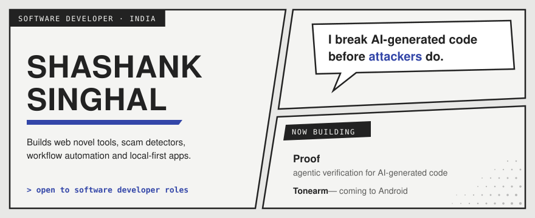
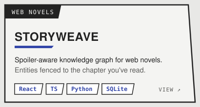
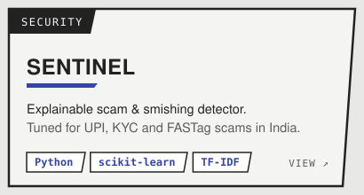
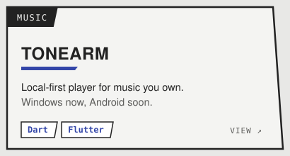
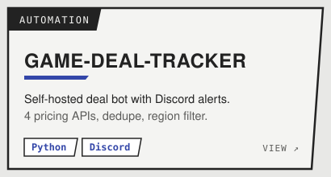
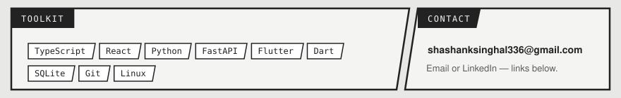

**Software developer** building workflow automation, local-first apps and tools that catch what AI-generated code gets wrong. Open to software developer roles.

<table>
<tr>
<td width="50%"></td>
<td width="50%"></td>
</tr>
<tr>
<td width="50%"></td>
<td width="50%"></td>
</tr>
</table>

<a href="mailto:shashanksinghal336@gmail.com">Email</a> ·
<a href="https://www.linkedin.com/in/YOUR-HANDLE">LinkedIn</a> ·
<a href="https://github.com/Shashank-ssls?tab=repositories">All repositories</a>

